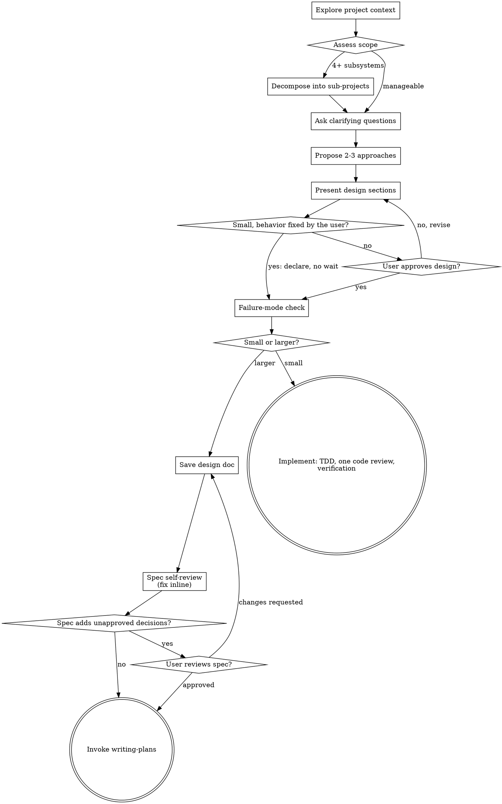

# Brainstorming

Turn rough requests into an approved design before implementation.

## Hard Gate

Do not write code, edit files, or invoke implementation skills until design approval is explicit. The one exception is small work under *Declare and Proceed* below, where a short statement of how you read the request comes before any code.

## Scale the Paperwork, Not the Design

Every change that reaches this skill gets a design before any code — a todo list, a single-function utility, a config change. For small work whose behavior the user already fixed, that design is the short statement under *Declare and Proceed*. "Simple" work is where unexamined assumptions waste the most effort. What scales with the size of the work is the paperwork around the design:

- **Small** — one subsystem, about three files or fewer, finishable in one sitting: present the design in the conversation (goal, approach, what changes, how it is tested, the failure-mode check from step 8) and get approval, or declare and proceed when that applies. Then implement with `test-driven-development`, run `requesting-code-review` once on the finished diff, and finish with `verification-before-completion`. No spec file, no plan file.
- **Larger** — anything else, or whenever the user asks for a written spec: the full checklist below, ending in `writing-plans`.

When you present the design, name the size you chose and why in one line, so the user can override it.

## Declare and Proceed (small work only)

When the user's request already fixes the behavior, waiting for an OK on a design that only repeats it costs a round trip and tells them nothing. In that case:
1. State in a few lines how you read the request: what you will build, where it goes, and any reading you chose.
2. Invoke `test-driven-development` in the same turn.
3. In your final report, list the edge cases the rules leave open as an offer to tighten.

It applies only when all of these hold:
- The work is small.
- The user's stated rules can be implemented as written. Everything else you add is placement, naming, or test layout.
- The failure-mode check found nothing critical.

Edge inputs the rules do not mention do not block. Example: rules for an email check that never say what happens with two `@` signs. Implement the literal reading and name it, for example "split at the first @, so `a@b@c.com` passes". Put the edge cases in the final report as an offer: "Your rules accept `a@b@c.com` and `a@.com`. Want those rejected?" Do not tighten them yourself.

Wait for approval instead when any of these is true:
- The request leaves a core choice open, so you cannot implement it without inventing behavior the user never described. Examples: "store phone numbers in one consistent format" without saying which format, which data to keep, or what text or flow a user sees.
- The design adds a dependency, or deletes or migrates data.
- The change touches security-relevant behavior.
- The user asked to see the design first.

When unsure whether a choice is core, wait.

## Checklist

1. Inspect project context (relevant files, docs, recent commits).
2. Assess scope: if the project touches 4+ independent subsystems or would require 20+ implementation tasks, decompose into sub-projects. Design each sub-project as a separate spec. Present the decomposition to the user for approval before designing individual specs.
3. Ask all clarifying questions together in a single turn. Use multiple-choice format where possible to reduce round trips. Ask first about the outcome the user wants and what their own words mean — "normal", "cheap", "real-time", "simple" can each mean several things, so ask which — and only then about implementation choices. Never ask what the project files or a source the user pointed to already answer; read those first.
4. Propose 2-3 approaches with trade-offs and a recommendation.
5. Present design in short sections; confirm each section. Small work: one short block, then one approval, or no wait under *Declare and Proceed*.
6. For existing codebases: study existing patterns before proposing new ones. Match the project's conventions unless there's a compelling reason to diverge. Design for isolation — prefer changes that minimize blast radius and don't require coordinating across many files.
7. If the repo lacks `CLAUDE.md` / `AGENTS.md` and long-term collaboration is expected, consider using `claude-md-creator` to create a minimal, high-signal context file.
8. **Before approving the design — failure-mode check:** State the top 2-3 ways the chosen approach could fail or not cover all cases. This is adversarial reasoning, not a list of known assumptions — actively try to break the design. For each failure mode found, assess severity:
   - **Critical** (design fails for a significant user scenario): revise the design before proceeding.
   - **Minor** (edge case, acceptable limitation): document as a non-goal in the design.
   Do not skip this step. An approach that survives adversarial questioning is an approach worth approving.
9. **Small work stops here** and goes to implementation (see *Scale the Paperwork*). Larger work: save the approved design to `docs/specs/YYYY-MM-DD-<topic>-design.md`.
10. **Spec self-review** — quick inline check for placeholders, contradictions, ambiguity, scope (see Spec Self-Review below). Fix issues inline; no subagent dispatch needed.
11. **User review of the written spec, when it adds something** — if the spec now holds decisions the user has not approved in the conversation, ask for a review of those (see User Review Gate below). Otherwise give the path and move on.
12. Invoke `writing-plans`.

## Process Flow

**Terminal state:** larger work ends by invoking `writing-plans`; small work ends by starting implementation with `test-driven-development`. Do not jump from here to other implementation skills such as `frontend-design` — they apply during implementation, not instead of it.

## Spec Self-Review

After writing the spec document, look at it with fresh eyes:

1. **Placeholder scan:** Any "TBD", "TODO", incomplete sections, or vague requirements? Fix them.
2. **Internal consistency:** Do any sections contradict each other? Does the architecture match the feature descriptions?
3. **Scope check:** Is this focused enough for a single implementation plan, or does it need decomposition?
4. **Ambiguity check:** Could any requirement be interpreted two different ways? If so, pick one and make it explicit.

Fix any issues inline. No need to re-review — just fix and move on.

## User Review Gate

After the spec self-review, compare the written spec with what the user approved in the conversation.

- **It holds decisions the user has not approved** — ambiguities you resolved, non-goals from the failure-mode check, anything the self-review changed: list exactly those and ask for review.

  > "Spec written to `<path>`. It adds these points you haven't approved yet: … Please review them (or the whole file) before I write the implementation plan."

  Wait for the response. If they request changes, make them and re-run the self-review. Proceed once they approve.
- **It only records the approved design** — say so with the path ("Spec written to `<path>`; it records the design you approved.") and invoke `writing-plans`. Asking for a second approval of text the user already approved costs a round trip and tells them nothing new.

## Design for Isolation and Clarity

- Break the system into smaller units that each have one clear purpose, communicate through well-defined interfaces, and can be understood and tested independently.
- For each unit, you should be able to answer: what does it do, how do you use it, and what does it depend on?
- Smaller, well-bounded units are easier to reason about — you reason better about code you can hold in context at once, and your edits are more reliable when files are focused.

## Design Contents

Include:
- Scope and non-goals
- Architecture and data flow
- Interfaces/contracts
- Error handling
- Testing strategy
- Rollout or migration notes (if needed)

## Engineering Rigor

Apply senior engineering judgment during design:
- Verify requirements are complete and unambiguous before designing.
- Identify edge cases, error paths, and cross-platform concerns early.
- Evaluate trade-offs explicitly (performance vs. readability, flexibility vs. simplicity).
- Prioritize modularity, SOLID principles, and production-ready standards.
- Flag architectural risks that will be expensive to fix later.

## Interaction Rules

- Batch all questions into a single turn; use multiple choice to reduce ambiguity.
- Remove non-essential scope (YAGNI). Do not add features the user did not ask for; if an extra seems worthwhile, offer it as an option in your questions — it enters the design only if the user picks it.
- If user feedback conflicts with prior assumptions, revise design before proceeding.

## Exit Criteria

- User approved the design. Under *Declare and Proceed*, a short statement of how you read the request came before any code.
- Failure-mode check completed — critical failure modes resolved, minor ones documented as non-goals.
- **Small work:** implementation starts with `test-driven-development`.
- **Larger work:**
  - Design document exists at the required path (`docs/specs/`).
  - Spec self-review completed — placeholders, contradictions, ambiguity, and scope issues resolved.
  - Any decision the spec added beyond the approved design was reviewed by the user.
  - `writing-plans` is invoked as the next skill.
